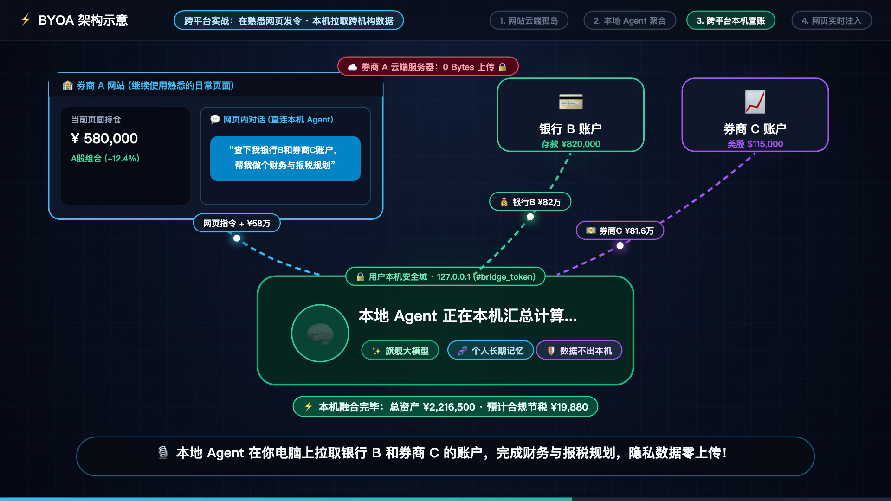
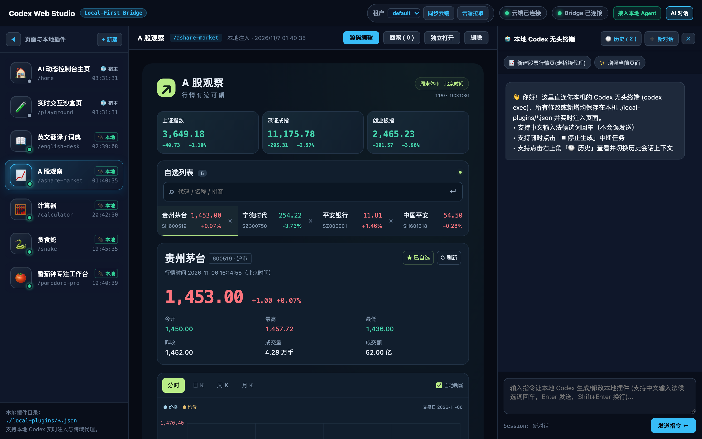
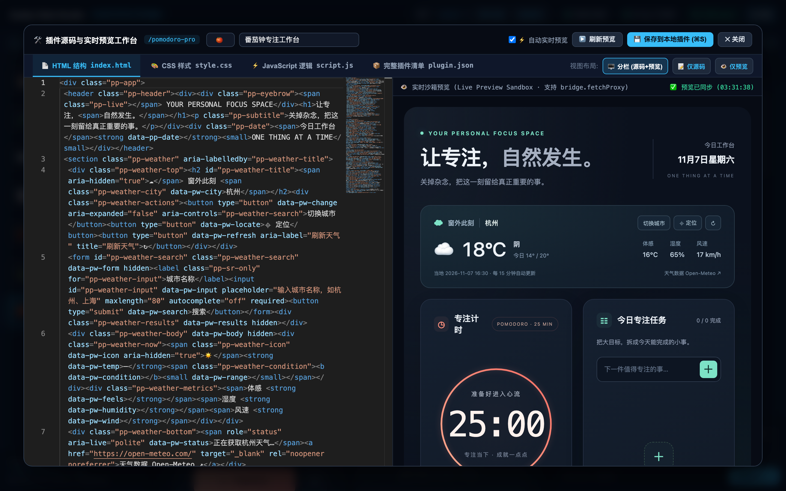
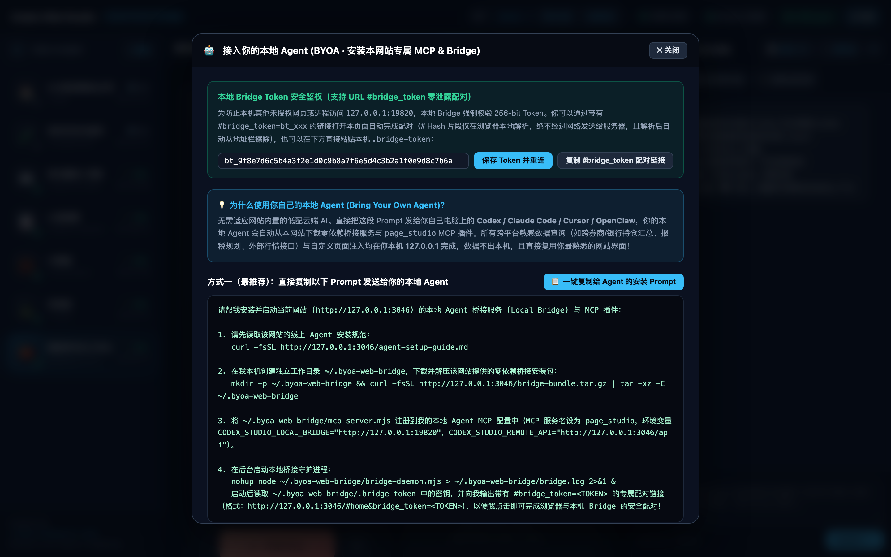

# ⚡ BYOA Web Agent Bridge (Bring Your Own Agent)

> **Empowering Existing Web Applications with Users' Local Sovereign Agents via MCP, Skills, and Local-First Runtime Injection.**  
> **拒绝每个网站重复造低配云端 AI：让万千既有网站以 MCP / Skills 聚合在用户自己的本地主权 Agent 之下，并通过本地桥接实现跨平台数据协同与页面动态注入。**

[](LICENSE)
[](https://nodejs.org/)
[](#architecture--system-design--系统架构设计)

[**🇬🇧 English Documentation**](#english-documentation) | [**🇨🇳 中文完整文档**](#中文完整文档) | [**💬 Prompt to Build This on Your Site**](#prompt-to-build) | [**🎬 Story Animation & Screenshots**](#screenshots)

---

<a id="screenshots"></a>

## 🎬 Voiced Motion Video Showcase: Why BYOA? / 配音动态示意视频：为什么要用用户自己的本地 Agent？

> **🔊 60-Second Voiced Schematic Video (With Chinese Neural Voiceover & Subtitles)**:  
> Watch how a user avoids siloed, downgraded website cloud AIs and instead puts their **own Local Sovereign Agent (`127.0.0.1:19820`)** at the center—plugging in **Broker A (`MCP`)**, **Bank B (`Skill`)**, and **Broker C (`Proxy`)**, computing cross-institution wealth & tax-loss harvesting plans **100% locally (0 bytes uploaded to Broker A's cloud)**, and dynamically injecting the visual dashboard straight into Broker A's webpage.  
> **🔊 60 秒全流程配音动态示意视频（非 PPT 堆砌文字，采用实时节点连线与数据流动画 + 语音旁白）**：直观演示为什么“每个网站自建云端小模型”会陷入重复调教与数据孤岛，以及 BYOA 如何把 **用户自己的本地 Agent** 放在中心位置，在熟悉的券商 A 网页内发令、本机拉取银行 B 与券商 C 算清财务与报税方案、并实时注入回原网页！
>
> 👉 **[🎬 Click to Watch / Download Full HD Voiced Video (`docs/images/byoa-story-demo.mp4`, with Audio 🔊)](docs/images/byoa-story-demo.mp4)**

[](docs/images/byoa-story-demo.mp4)

---

## 🖼️ Live Workbench Screenshots / 实际运行工作台截图

### 1. Local-First Plugin Workbench & Cross-Origin Real-Time Stock Terminal (`bridge.fetchProxy`)
> Real-time stock quotes fetched via the Local Bridge CORS Proxy (`127.0.0.1:19820/proxy`), with the Large-Icon Plugin Sidebar on the left and the Local Headless Agent Chat on the right.  
> 通过本地桥接代理实时拉取股票行情并注入页面，左侧为支持大图标折叠的插件导航，右侧为直连本机无头终端的 AI 对话栏。



### 2. Multi-Tab Monaco Editor IDE + Live Split-Screen Sandbox Preview
> Built-in VS Code Monaco Editor (`HTML` / `CSS` / `JavaScript` / `Plugin JSON`) with real-time sandbox preview (`bridge.fetchProxy` weather widget + Pomodoro timer) and revision rollback.  
> 内置多标签 Monaco Editor 源码工作台与实时分栏沙箱预览（展示注入到番茄钟页面的实时天气挂件）。



### 3. One-Click Local Agent Onboarding Prompt & `#bridge_token` Zero-Leakage Pairing
> Users simply copy a single prompt to their local Agent (`Codex` / `Claude Code` / `Cursor` / `OpenClaw`) to auto-install the Bridge & MCP tools and pair via RFC 3986 URL Fragment (`#bridge_token=<TOKEN>`).  
> 一键复制安装指令发给用户的本地 Agent 自动完成 MCP 与 Bridge 部署，并通过 URL `#bridge_token` 实现零网络泄露的安全配对。



---

<a id="english-documentation"></a>

## 🌍 Vision & Motivation: Why "Bring Your Own Agent" (BYOA)?

### The Broken Status Quo: Every Website Building Its Own Siloed Cloud AI

Today, when existing web applications and SaaS platforms try to "add AI capabilities," their default instinct is to build an **in-house, platform-specific Cloud Agent** hosted on their own backend servers. While well-intentioned, this approach hits three fundamental walls:

1. **The Cost–Intelligence Dilemma**: Because SaaS providers must bear the token inference cost for millions of users, their built-in cloud agents almost always use downgraded, cheaper models (`mini`/`flash` tiers) with heavily truncated context windows and restricted tool-use loops.
2. **Cloud Sandbox Silos**: A cloud agent running on *Website A*'s backend is strictly trapped inside *Website A*'s boundary. Due to commercial competition, authentication barriers, and data privacy regulations, *Website A*'s cloud agent can never access the user's accounts on *Website B*, *Bank C*, or the user's local filesystem.
3. **The Fragmented Alignment Tax**: In the Agentic era, users do not want to train, prompt, and align **50 mediocre, disconnected AI assistants across 50 different websites**. Instead, every user increasingly owns **one deeply personalized Local Sovereign Agent** (e.g., Claude Code, OpenAI Codex CLI, Cursor, OpenClaw) powered by frontier models, holding their long-term memory, personal preferences, and local toolchains.

---

### The BYOA Paradigm Shift: Unifying Platforms Under the User's Local Agent

Instead of forcing users to use a website's weak built-in AI—or forcing users to abandon the mature web interfaces they already use every day—**BYOA Web Agent Bridge** flips the architecture:

```
                   ┌──────────────────────────────────────────────────────────┐
                   │        👤 User's Personal Local Sovereign Agent           │
                   │   (Codex CLI / Claude Code / Cursor / OpenClaw + LLM)    │
                   │   Unified Memory · Frontier Model · Local Security Box   │
                   └───────────┬──────────────────────────────────┬───────────┘
                               │                                  │
        ┌──────────────────────┴────────┐                ┌────────┴──────────────────────┐
        ▼ (Aggregated via MCP / Skills) ▼                ▼ (Via Local Bridge 127.0.0.1)  ▼
┌───────────────┐  ┌───────────────┐  ┌───────────────┐  ┌───────────────────────────────────────┐
│   Bank B API  │  │  Broker C API │  │ Local Tax/CSV │  │   High-Frequency Web App (Broker A)   │
│ (Bank B Skill)│  │(Broker C MCP) │  │ (Local Files) │  │ (Keep Familiar UI + Inject Dashboards)│
└───────────────┘  └───────────────┘  └───────────────┘  └───────────────────────────────────────┘
```

1. **All Platforms Aggregate as `Skills / MCP` Under the User's Agent**:
   Every web platform exposes its capabilities as standard **MCP (Model Context Protocol) servers or Skills**. The user's personal agent can orchestrate services across multiple platforms simultaneously.
2. **Operate the Web App Directly from the Local Agent — or Invoke the Local Agent Inside the Web App**:
   Through a lightweight **Local Bridge Daemon (`ws://127.0.0.1:19820`)**, users can chat inside the web application's UI while actually driving their own local headless agent (`codex exec`, `claude -p`).
3. **Cross-Platform Data Mashups with 100% Local Privacy (The Financial & Tax Planning Example)**:
   - Imagine you are browsing **Broker A's website** (your favorite daily trading terminal).
   - You ask the chat panel inside Broker A's website:  
     *"Query my account balances and realized gains from **Bank B** and **Broker C**, combine them with my current portfolio on **Broker A**, build a cross-account asset rebalancing & annual tax-loss harvesting plan, and render an interactive tax simulator right here on Broker A's dashboard."*
   - **How it works safely**:
     - Your local agent queries Bank B, Broker C, and your local tax spreadsheets **entirely on `localhost`** (via local MCP skills and the local CORS proxy `bridge.fetchProxy`).
     - **Zero sensitive data from Bank B or Broker C is ever uploaded to Broker A's backend servers.**
     - The resulting interactive dashboard is saved as a local plugin (`./local-plugins/tax-planner.json`) and dynamically injected into Broker A's browser DOM!
     - You keep using the familiar website you love, powered by your strongest local agent, with complete cross-platform data sovereignty.

---

### Comparison: Siloed Cloud AI vs. BYOA Local Agent Bridge

| Dimension | Traditional Built-In Website Cloud AI | BYOA Local Agent + Web Bridge (This Project) |
| :--- | :--- | :--- |
| **Model Intelligence** | Capped by website's token budget (often small/cheap models) | **Frontier models** chosen by the user (Claude Opus/Sonnet, GPT-5/Codex, Local LLMs) |
| **Memory & Personalization** | Siloed per website; users must re-teach every site's AI | **Single Sovereign Agent** retains unified user memory & preferences across all sites |
| **Cross-Platform Synergy** | Trapped in a single website's backend sandbox | **Native cross-platform orchestration** across Bank B, Broker C, local files & 3rd-party APIs |
| **Data Privacy & Compliance** | Requires uploading sensitive data to third-party servers | **100% Localhost Execution**: sensitive cross-site data never leaves the user's machine |
| **Code Execution Security** | Risk of server-side RCE or multi-tenant pollution | **Zero Server-Side Code Execution**: plugins run in the client browser sandbox |
| **User Habits & UI** | Forces users into separate chat apps or new platforms | **Zero switching cost**: extends the high-frequency websites users already use daily |

---

## 🏗️ Architecture & Key Capabilities

1. **Local-First Plugin Injection (`./local-plugins/*.json`)**:
   - Agent-created pages (`custom-page`) and DOM widget patches (`page-patch`) are stored on the user's machine and hot-injected into the live browser over WebSocket (`ws://127.0.0.1:19820`) within milliseconds.
2. **Local Bridge CORS & Charset Proxy (`POST http://127.0.0.1:19820/proxy`)**:
   - Injected browser plugins can call `await bridge.fetchProxy(url, options)` (or standard `fetch`, which is automatically intercepted for cross-origin URLs) to query external APIs (e.g., stock market quotes, financial APIs) with custom `Referer`/`User-Agent` headers and automatic `GB18030` / `GBK` -> `UTF-8` decoding, completely bypassing browser CORS restrictions.
3. **Multi-Tenant Static Cloud Sync (`/api/user/plugins`)**:
   - When users log in across multiple devices, their local plugin JSON manifests can be backed up and restored from isolated per-user cloud storage (`/api/user/plugins?userId=<id>`). The cloud server treats plugins strictly as static JSON strings and **never executes user code on the server**.
4. **Full Web IDE & Agent Chat Workbench**:
   - **Collapsible Large-Icon Navigation Dock** & **Collapsible Right AI Chat Panel**.
   - **CJK IME Composition Guard**: Prevents pressing `Enter` during Chinese/Japanese candidate selection from accidentally submitting prompts.
   - **Single-Flight Concurrency Lock & Stop Generation (`⏹ Stop`)**: Terminates running headless agent subprocesses via `SIGTERM`/`SIGKILL`.
   - **Persistent Multi-Session History Switcher**: Switch between historical agent threads (`threadId`) at any time.
   - **Embedded Monaco Editor (`v0.47.0`) + Split Live Preview Sandbox**: Edit `HTML`, `CSS`, `JavaScript`, and `Plugin JSON` with instant live preview and revision rollback.
   - **Standalone Runner for Local Plugins (`/p/<slug>`)**: Open any local plugin in its own dedicated browser tab with full `window.agentBridge` support.

---

## 📋 Example: Standard Prompt to Give Your Local Agent to Install a Website's MCP & Bridge

Any web application adopting the BYOA pattern can host a zero-dependency `bridge-bundle.tar.gz` and `/agent-setup-guide.md`, allowing users to simply copy-paste a single prompt into their local Agent (**Codex / Claude Code / Cursor / OpenClaw**) to wire everything up automatically:

```markdown
Please install and start the Local Agent Bridge and MCP Server for the web application (https://your-web-app.example.com):

1. Read the online Agent onboarding specification:
   curl -fsSL https://your-web-app.example.com/agent-setup-guide.md

2. Create a dedicated local workspace at ~/.byoa-web-bridge, and download & extract the zero-dependency bridge bundle:
   mkdir -p ~/.byoa-web-bridge && curl -fsSL https://your-web-app.example.com/bridge-bundle.tar.gz | tar -xz -C ~/.byoa-web-bridge

3. Register ~/.byoa-web-bridge/mcp-server.mjs in my local Agent MCP configuration:
   - Server Name: page_studio
   - Command: node ~/.byoa-web-bridge/mcp-server.mjs
   - Environment:
     CODEX_STUDIO_LOCAL_BRIDGE="http://127.0.0.1:19820"
     CODEX_STUDIO_REMOTE_API="https://your-web-app.example.com/api"

4. Start the Local Bridge Daemon in the background:
   nohup node ~/.byoa-web-bridge/bridge-daemon.mjs > ~/.byoa-web-bridge/bridge.log 2>&1 &
   Then read the 256-bit secret token from ~/.byoa-web-bridge/.bridge-token and output the one-click URL Fragment pairing link (https://your-web-app.example.com/#home&bridge_token=<TOKEN>) so I can click it to pair my browser with the local bridge with zero network leakage!
```

### 🔒 Zero-Leakage Local Bridge Token Authentication (`#bridge_token`)

To prevent untrusted local processes or drive-by malicious websites from invoking `127.0.0.1:19820`:
- **256-bit CSPRNG Token (`0600` file permissions)**: On startup, `bridge-daemon.mjs` generates a random secret (`bt_...`) in `~/.byoa-web-bridge/.bridge-token` (`chmod 0600`).
- **RFC 3986 URL Fragment Pairing (`#bridge_token=<TOKEN>`)**: Users open `https://your-web-app.example.com/#home&bridge_token=<TOKEN>`. Because URL fragments (`#...`) are **never sent in HTTP requests or `Referer` headers**, the remote web server never sees the token. The browser JS extracts `bridge_token` into `localStorage` and immediately scrubs the address bar via `history.replaceState`.
- **Constant-Time Verification (`crypto.timingSafeEqual`)**: Every WebSocket connection (`?token=<TOKEN>`) and HTTP request (`X-Bridge-Token: <TOKEN>`) is strictly verified.

---

<a id="prompt-to-build"></a>

## 💬 How to Ask Your Coding Agent to Add This to Your Own Website (Conversational Prompt)

If you already have an existing website and want your AI coding assistant to build this **BYOA (Bring Your Own Agent)** capability into it—without having to explain low-level technical specs—just copy and paste the conversational requirement prompt below:

### 🇬🇧 Conversational Prompt (English)

> "I have an existing web application, and instead of building a standard cloud chatbot on my backend, I want to let users **bring and connect their own local AI Agent** (like Claude Code or Codex) to my website. Here is what I want from a user experience perspective:
>
> 1. **Two-way interaction between my web UI and the user's local Agent**:
>    Add a collapsible AI chat panel on the right side of my website (make sure pressing Enter during CJK IME composition doesn't accidentally submit, allow stopping an active generation, enforce one task at a time, and let users switch between historical chat sessions). When a user chats here, it should drive the headless Agent on their own computer. Conversely, when the user talks to their local Agent in their terminal, the Agent should be able to inspect and manipulate the live webpage.
> 2. **One-click onboarding prompt for the user's Agent + token security**:
>    Put a 'Connect Local Agent' button in the top bar. Clicking it should give the user a ready-to-copy prompt they can paste straight into their local Agent, instructing their Agent to download the bridge/MCP bundle hosted on my site and start it up. For security, the local bridge service must require a secret token, and support pairing via a `#` URL fragment link so the token is never sent to my server.
> 3. **All Agent-created pages and modifications stay local and render via runtime injection (never modify my server code)**:
>    Whether the user asks their Agent to add a widget to an existing page or build a brand-new tool page, keep all generated code on the user's local machine and inject it into the webpage in real time. Let users switch pages via a left sidebar (which can collapse into large icons), open local pages in standalone URLs, and inspect/edit the code using a mature multi-tab code editor with live split-screen preview and version rollback.
> 4. **Local cross-origin API relay & multi-user static cloud sync**:
>    If the user's custom page code needs to fetch data from external third-party APIs (like stock quotes or other platforms), route those requests through their local bridge service to avoid browser CORS errors while keeping sensitive data strictly on their machine. Finally, support multi-user accounts where a user's local plugins can be synced to and from my server as pure static data so they can access their customizations on another computer—without my server ever executing user code."

---

<a id="中文完整文档"></a>

## 🇨🇳 中文完整文档：项目背景、战略意义与技术架构

### 一、 项目出发点：为什么“每个网站各自造一个云端 Agent”是一条死胡同？

当前几乎所有存量网站与 Web 应用在探索“如何增加 AI 能力”时，默认做法都是在网站自己的后端接入大模型，做一个**网站内置的云端 AI / Agent**。但在真实深水区应用中，这种模式存在三个致命缺陷：

1. **网站成本与模型智商的天然矛盾**：
   受制于网站自身的 Token 推理成本，网站内置 AI 往往只能采用降级版小模型、阉割上下文长度与工具调用轮数，效果远不如用户自己订阅的旗舰模型。
2. **云端沙箱的视野局限与平台孤岛**：
   网站内置的 Agent 运行在单一网站的云端服务器上，出于商业竞争与安全隔离，它永远无法读取用户在其他平台、其他金融机构或本地电脑中的数据，能力边界被锁死在单一站点内部。
3. **碎片化的“重复调教税”**：
   实际上，未来每个人都会拥有自己长期使用、深度调教的**个人主权本地 Agent（如 Claude Code、Codex、Cursor、OpenClaw 等）**。与其让用户在 100 个不同的网站上使用 100 个互不相通的平庸 Agent、逼着用户挨个重新调教，**为什么不直接让网站接入用户自己的本地 Agent？**

---

### 二、 BYOA (Bring Your Own Agent) 核心理念：以用户本地 Agent 彻底打通跨平台服务与数据

本项目的核心愿景是建立 **“用户本地主权 Agent + 万千现有网站 MCP/Bridge 协同”** 的新一代 Web 扩展范式：

1. **所有平台以 `Skills / MCP` 形式聚合在用户的本地 Agent 之下**：
   - 用户既可以在本地 Agent 终端里直接调用各个网站平台的服务；
   - 也可以在浏览任意网站时，在网页内直接唤醒并使用自己调教好的本地 Agent；
   - 甚至可以在 A 网站的页面内，通过自己的本地 Agent 跨平台调用 B 平台、C 平台的服务与数据！
2. **典型场景推演：在「券商 A」网站上跨银行/跨券商做财务规划与报税**
   - 假设用户日常高频使用**券商 A** 的网站看盘，但资产同时分散在**银行 B**、**券商 C** 以及本地税务表格中。
   - 用户直接在**券商 A 网站的对话栏**里对自己的本地 Agent 说：
     > *“请查询我在其他银行 B / 券商 C 的账户持仓与流水情况，结合当前券商 A 的账户资产，帮我做一份综合财务规划与年度报税测算，并把交互式看板直接渲染在当前网页上。”*
   - **为什么只有本地 Agent 架构能完美实现？**
     - **数据安全与隐私有绝对保障**：跨银行/跨券商账户查询、敏感流水对齐与税务计算 **100% 在用户本地电脑（Localhost）完成**，银行 B 和券商 C 的私有数据**绝不会上传到券商 A 的服务器**；
     - **无需重做新网站，完整保留用户使用习惯**：计算完成后，本地 Agent 直接生成定制化前端组件并通过本地桥接（`127.0.0.1:19820`）实时注入到用户高频使用的券商 A 网页中显示——用户无需迁移到陌生的新软件，即可在最顺手的现有网站上获得跨平台超级 Agent 能力！

---

### 三、 给本地 Agent 自动安装网站 MCP / Bridge 的标准说明示例

网站无需让用户手动折腾繁琐的配置，只需在网页上提供如下一段 **Agent 专用安装 Prompt**（并托管对应的 `bridge-bundle.tar.gz` 安装包）。用户复制这段话发给自己的本地 Agent，Agent 即可全自动完成安装与配对：

```markdown
请帮我安装并启动当前网站 (https://your-web-app.example.com) 的本地 Agent 桥接服务 (Local Bridge) 与 MCP 插件：

1. 请先读取该网站的线上 Agent 安装规范：
   curl -fsSL https://your-web-app.example.com/agent-setup-guide.md

2. 在我本机创建独立工作目录 ~/.byoa-web-bridge，下载并解压该网站提供的零依赖桥接安装包：
   mkdir -p ~/.byoa-web-bridge && curl -fsSL https://your-web-app.example.com/bridge-bundle.tar.gz | tar -xz -C ~/.byoa-web-bridge

3. 将 ~/.byoa-web-bridge/mcp-server.mjs 注册到我的本地 Agent MCP 配置中（MCP 服务名设为 page_studio，环境变量 CODEX_STUDIO_LOCAL_BRIDGE="http://127.0.0.1:19820"，CODEX_STUDIO_REMOTE_API="https://your-web-app.example.com/api"）。

4. 在后台启动本地桥接守护进程：
   nohup node ~/.byoa-web-bridge/bridge-daemon.mjs > ~/.byoa-web-bridge/bridge.log 2>&1 &
   启动后读取 ~/.byoa-web-bridge/.bridge-token 中的 256-bit 密钥，并向我输出带有 #bridge_token=<TOKEN> 的专属安全配对链接（格式：https://your-web-app.example.com/#home&bridge_token=<TOKEN>），以便我点击即可完成浏览器与本机 Bridge 的零泄露鉴权配对！
```

---

### 四、 如果我想基于自己现有的网站开发类似功能，应该怎么跟 Agent 说？（纯口语化需求模板）

当你想把这套 **“让用户接入自己本地 Agent 扩展现有网站”** 的能力加到你自己的网站上时，不需要讲复杂的技术实现，直接把下面这段**口语化的需求描述**发给你的编程 Agent 即可：

> “我现在有一个已经在线运行的网站，我想给它加上一套**‘让用户接入自己本地 AI Agent’**的能力，而不是在网站后台自己接个大模型做普通客服。具体我想实现这几个效果：
>
> 1. **在网页里直接跟自己电脑上的 Agent 对话，也能在本地 Agent 里反过来操作网页**：
>    用户打开我的网站后，右边有一个可以随时收起和展开的 AI 对话框（注意处理好中文输入法按回车选词时别误发送、支持随时点击停止生成、同时只能跑一个任务、还能查看和切换历史对话）。用户在这里发消息，实际调用的是他自己电脑上的本地 Agent（比如 Claude Code 或 Codex）；反过来，用户在自己电脑终端的 Agent 里下指令，也能直接读取我当前网页的内容、或者直接操作我的网页。
> 2. **一键引导用户的本地 Agent 自动安装连接工具**：
>    在网站顶部放一个‘接入本地 Agent’的按钮。用户点开就能直接复制一段话发给他自己的本地 Agent，让他本地的 Agent 自动从我网站下载配套的桥接服务和工具插件并启动。为了安全，本地服务必须带访问密钥（支持点击网页链接里 `#` 号后面的参数自动完成配对，这样密钥不会发到我的服务器），防止用户电脑上别的程序或别的网页乱调。
> 3. **用户让 Agent 改页面或加新功能，代码都保存在用户本地、通过注入显示，绝不直接改我的服务器代码**：
>    无论是用户在老页面上让 Agent 加个小组件（比如加个天气、数据卡片），还是让 Agent 新做一个完整的工具页（比如计算器、看板、小游戏），这些生成的代码都保存在用户自己电脑本地，通过本地连接实时注入到我的网页里显示出来，还能在左侧导航栏（支持折叠成大图标）切换，或者用独立链接在新窗口打开。同时网页里要提供一个带多标签（HTML/CSS/JS）和实时分栏预览的成熟代码编辑器，方便直接看源码、预览和回滚版本。
> 4. **支持跨平台查数据（本地中转免跨域）和多用户云端同步备份**：
>    如果 Agent 给用户写的页面代码需要去调外部其他网站的接口（比如查股票行情、或者查其他平台的数据），直接通过用户本地的连接服务中转请求，绕过浏览器的跨域限制，而且敏感数据全在用户本地处理、不经过我的服务器。另外要支持多用户登录，用户本地做好的这些扩展页面和插件，可以作为纯静态数据同步备份到他自己的云端账号下，换台电脑登录就能拉下来继续用，但我的服务器绝对不能执行任何用户上传的代码。”

---

## 🚀 Quick Start / 快速运行指南

### Prerequisites / 环境要求
- **Node.js** `>= 18.0.0` (Zero external npm dependencies required! 纯原生 Node.js 模块实现，零第三方依赖)
- Optional local CLI Agent: OpenAI `codex` CLI or `claude` CLI for headless execution from the web chat panel.

### 1. Start the Host Web Application Server / 启动宿主网站服务端
```bash
npm run server
# Host Web App listening on http://127.0.0.1:3045
```

### 2. Start the Local Bridge Daemon / 启动本地桥接守护进程 (127.0.0.1:19820)
```bash
npm run bridge
# 🚀 Local Codex Bridge Daemon (Local-First Injection + CORS Proxy) on ws://127.0.0.1:19820
```

### 3. Open the Web Studio in Browser / 在浏览器打开工作台
Visit `http://localhost:3045`:
- Click **`📦 接入本地 Agent (安装 MCP/Bridge)`** in the top bar to view the one-click Agent Onboarding Prompt and downloadable bundle (`bridge-bundle.tar.gz`).
- Use the right-hand AI Chat Panel, the built-in **Monaco Multi-Tab IDE + Live Split Preview**, or run your local Agent in the terminal with `mcp-server.mjs` mounted to inject new pages and widgets in real time!

---

## 📂 Repository Structure / 项目目录结构

```text
.
├── bridge-daemon.mjs            # Local Bridge Daemon (ws/http 127.0.0.1:19820, CORS proxy, plugin hot-reload, headless agent runner)
├── mcp-server.mjs               # Standard stdio MCP Server (`page_studio`) exposing 7 live browser & plugin tools
├── AGENTS.md                    # Specification for Local Agents (plugin schema, bridge.fetchProxy CORS guide, lifecycle cleanup)
├── package.json                 # Zero-dependency Node.js package manifest
├── local-plugins/               # Local-first plugins & pages injected into the browser at runtime
│   ├── ashare-market.json       # Real-time stock market terminal plugin (using bridge.fetchProxy)
│   ├── calculator.json          # Scientific calculator & unit converter plugin
│   ├── english-desk.json        # Bilingual reading & flashcards workbench plugin
│   ├── pomodoro-pro.json        # Pomodoro focus timer & task manager plugin
│   └── snake.json               # Neon arcade snake game plugin
├── server-app/
│   ├── server.mjs               # Host Web Server + Multi-Tenant Static Plugin Sync + Standalone Runner (/p/:slug) + Installer routes
│   └── public/
│       ├── index.html           # Studio Frontend (Collapsible large-icon dock, Monaco IDE, IME guard, session history, BYOA setup modal)
│       └── bridge-bundle.tar.gz # Pre-packaged zero-dependency Local Bridge & MCP installer bundle
└── docs/
    ├── BYOA_MANIFESTO_CN.md     # In-depth manifesto on BYOA (Bring Your Own Agent) & cross-platform local data sovereignty
    └── TECHNICAL_ARCHITECTURE_CN.md # Detailed technical architecture, security model & CORS proxy specification
```

---

## 📄 License

MIT License.
